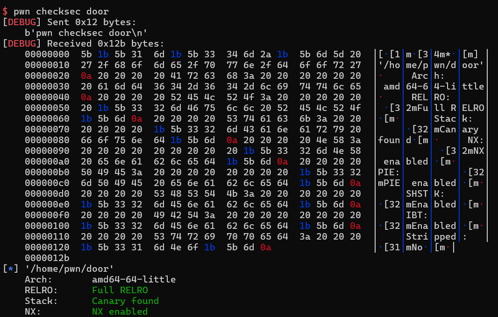
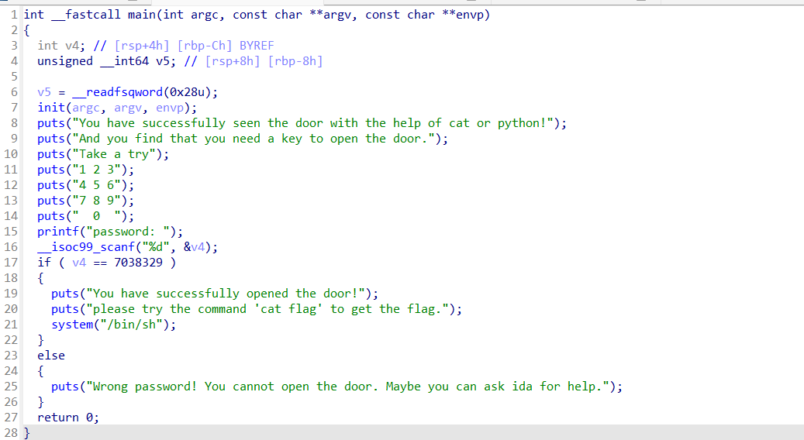
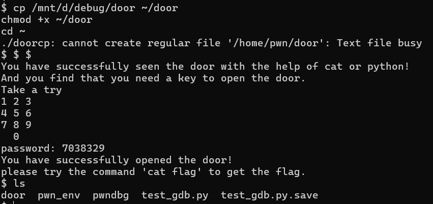
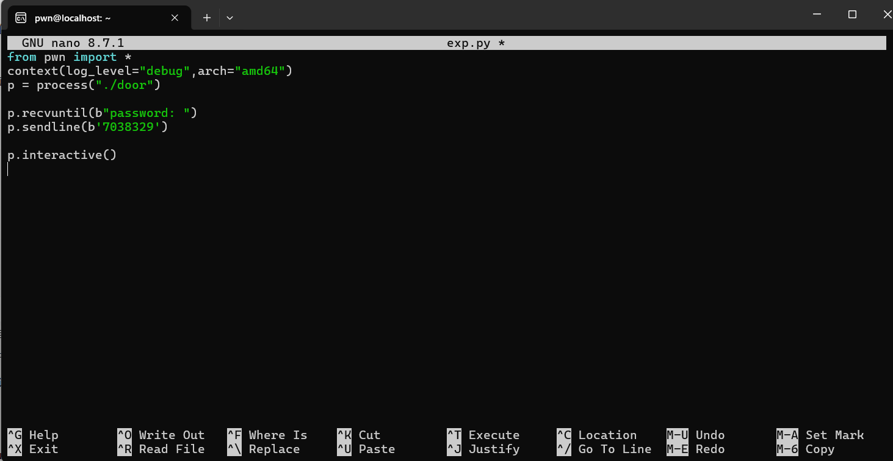
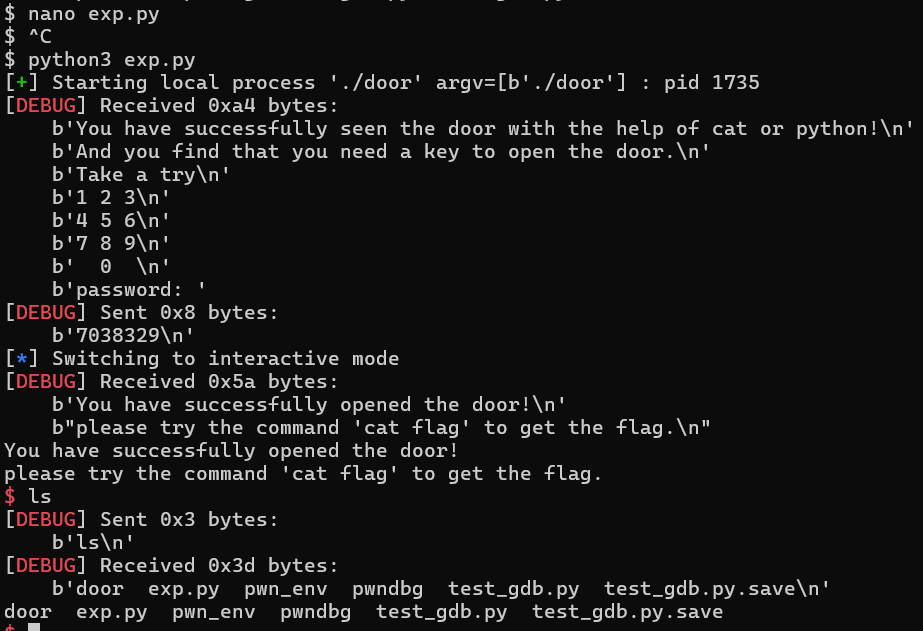

wp：

**一、检查题目保护**

[bash]pwn checksec door（pwntools自带的检查代码）

\

**二、反编译寻找漏洞**  

由\__\_isoc99_scanf("%d",\&v4);看出需要输入一个数字进行密码验证，验证成功则进行if语句  
但这道题没有严格意义上的漏洞，只需要输入正确密码就能拿到shell

**三、虚拟机验证漏洞**  

[bash]cp /mnt/d/debug/door ~/door 
（**复制文件**：把 Windows D 盘 `debug` 文件夹里的 `door` 文件，复制到 WSL 的家目录（`~` 就是 `/home/pwn`）下，命名为 `door`）

[bash]chmod +x ~/door
（**加执行权限**：`chmod` 改权限，`+x` 就是给文件加 "可执行" 属性。Windows 拷过来的文件默认没有这个权限，不加会报 Permission denied）

[bash]cd ~
（**切换目录**：`cd` 是 change directory，`~` 代表当前用户的家目录 `/home/pwn`）

[bash]./door
（**运行当前目录下的 door 程序**：`./` 表示 "当前目录"，Linux 默认不会在当前目录找可执行文件，必须显式写 `./`）

测试完毕，输入ls，输出文件目录即可

\

**四、编写exp**

输出文件目录，打通成功

**总结（漏洞利用链）**：

1. IDA F5 反编译 main 函数

2. 发现比较常量 0x6B6579 = 十进制 7038329

3. 输入密码 7038329

4. 直接进入 system("/bin/sh") 拿 shell
